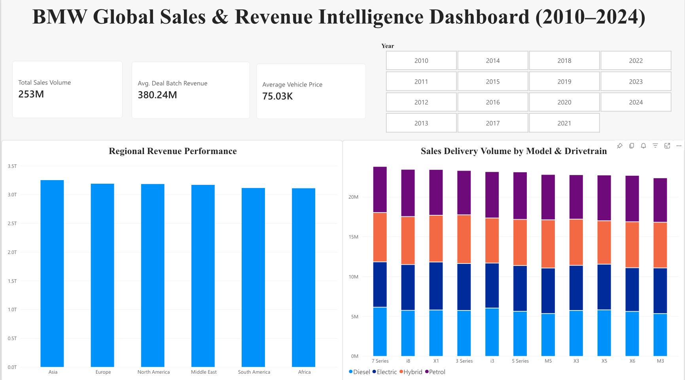

# BMW Sales & Revenue Dashboard (2010-2024)

An interactive Power BI dashboard that gives a commercial team one view of global sales performance: revenue by region, volume by model, and powertrain mix over time. Built on a public dataset of 50,000 sales records covering 2010-2024.

## Business Questions Answered

| Question | Where to find it |
|---|---|
| Which regions drive revenue, and is it concentrated or evenly spread? | Regional Revenue Breakdown |
| Which models and series sell the most? | Model Analytics |
| How is the mix shifting between Petrol, Diesel, Hybrid and Electric? | Powertrain Analytics |
| How have volume and revenue trended year over year? | Year Slicer + KPI Banner |

## Dashboard Preview

## Key Findings

* Revenue is spread across all 6 regions, with no single region dominating.
* Volume is balanced across 11 models; the top 3 (7 Series, i8, X1) account for 27.9% of units.
* Powertrain mix is stable from 2010 to 2024, with Electric + Hybrid near 50% throughout.

## Data

**Source:** https://www.kaggle.com/datasets/y0ussefkandil/bmw-sales2010-2024, 50,000 records, 2010–2024.

**Data note:** each row is a batch of vehicles, not a single car. Summing raw columns overstates real volumes, so headline metrics use averages per record and shares rather than raw totals.

| Metric | Definition |
|---|---|
| Total Sales Volume | Sum of `Sales_Volume` across all records |
| Average Vehicle Price | Mean `Price_USD` per vehicle ($75.03K) |

**Processing (Python / Pandas):** `process_bmw.py` adds a `Total_Revenue` column (`Price_USD × Sales_Volume`), renames `Model` to `Vehicle_Model`, and saves the output to `data/bmw_digital_sales_2010_2024.csv`.

## Data Model & Measures

* Power Query loads the processed CSV into a single table.
* DAX measures: Total Sales Volume, Average Batch Revenue, Regional Revenue Share %, Powertrain Share %.

## Run It Locally

1. Clone the repository.
2. Install dependencies: `pip install pandas`
3. Run `python process_bmw.py` to generate `data/bmw_digital_sales_2010_2024.csv`.
4. Optionally, open `bmw_sales_dashboard.pbix` in Power BI Desktop and point its data source to that file.

## Limitations & Next Steps

* The published dashboard reflects an earlier data load, so its figures may not match the processed file in this repo exactly.
* The dataset is public and batch-based, so absolute volumes aren't comparable to BMW's reported figures. The dashboard is for analysis practice, not financial reporting.
* Possible extensions: YoY growth and forecast views, a targets-vs-actuals page, row-level security by region.
